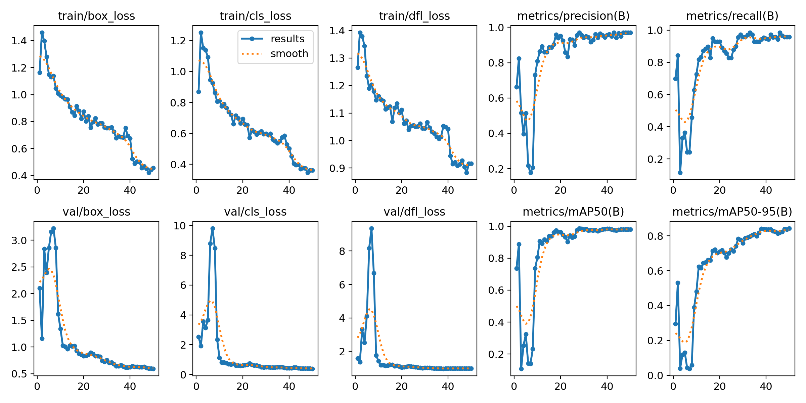
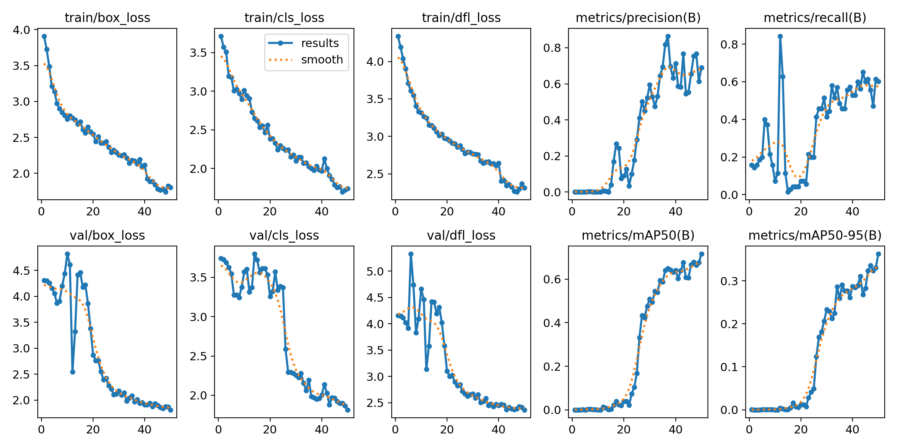
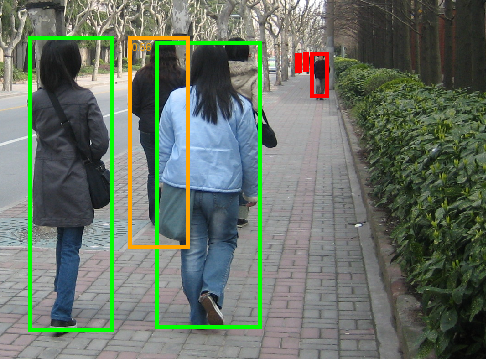
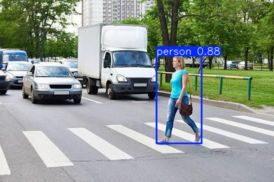

# Technical Report: Pedestrian Detection with YOLOv8

## 1. What problem does the project solve?

The project detects pedestrians in images: for each photo the model returns a bounding box around every person it finds, a confidence score for each box, and the total number of people. This is a basic building block for applications such as counting people in a street or shop, monitoring safety zones (for example, warning when someone walks into an area where vehicles operate), or analysing foot traffic. The result is served through a small web API, so any other program can send an image and get the detections back as JSON or as an annotated image.

## 2. Why this data, model and approach?

**Data.** I used the Penn-Fudan Pedestrian dataset: 170 street photos with 423 labelled pedestrians. It is small enough to train on a free Colab GPU in minutes, but realistic (real streets, people at different sizes, partly hidden people). The dataset provides segmentation masks rather than boxes, so I wrote `prepare_data.py` to convert each person's mask into a YOLO bounding box, and split the images 70/15/15 into train (118), validation (25) and test (27) with a fixed seed, so the split is reproducible. I then drew the converted boxes back on the images (`check_labels.py`) to confirm the conversion was correct.

**Model.** I chose YOLOv8 because it is a fast, modern one-stage detector with a well-maintained library. I started with the smallest size, YOLOv8n, which trains in about 2 minutes on a T4 GPU and runs quickly on a CPU.

**Approach.** With only 118 training images, training from random weights is unlikely to work well, so I fine-tuned weights pretrained on the COCO dataset (which already includes a "person" class). Experiment 1 tested whether this assumption was right, and Experiment 2 tested whether a bigger model would help. Based on Experiment 2, the final model is YOLOv8n: it reached the same accuracy as YOLOv8s while being 3.5× smaller.

## 3. Experiments and results

All experiments use the same split, seed (42), image size (640) and batch size (16); results are on the validation set.

| Experiment | Epochs | mAP50 | mAP50-95 | Precision | Recall |
|---|---|---|---|---|---|
| YOLOv8n pretrained | 50 | 0.982 | 0.842 | 0.971 | 0.967 |
| YOLOv8n from scratch | 50 | 0.696 | 0.356 | 0.580 | 0.672 |
| YOLOv8n from scratch | 150 | 0.924 | 0.604 | 0.897 | 0.870 |
| YOLOv8s pretrained | 50 | 0.988 | 0.842 | 0.972 | 0.984 |

**Experiment 1: pretrained vs. from scratch.** After 50 epochs the pretrained model reached mAP50 0.982, while the model trained from scratch reached only 0.696. The scratch model's loss curves were still going down at epoch 50, which suggested it was undertrained, so I gave it 150 epochs. It improved to 0.924, but was still clearly worse, especially on the stricter mAP50-95 (0.604 vs 0.842), meaning its boxes are less precise. With this little data, pretrained weights are the main reason the model works well.

**Experiment 2: YOLOv8n vs. YOLOv8s.** YOLOv8s gave essentially the same accuracy (mAP50 0.988 vs 0.982, identical mAP50-95 of 0.842), while being 3.5× larger (22.5 MB vs 6.5 MB) and needing 3.3× more computation (28.4 vs 8.6 GFLOPs). For a single-class task with limited data, the extra capacity brings no meaningful benefit, so I chose YOLOv8n as the final model.

**Final test score.** I evaluated the final model once on the 27 test images (67 people), which were not used for training or for choosing between models:

| mAP50 | mAP50-95 | Precision | Recall |
|---|---|---|---|
| **0.949** | **0.782** | 0.883 | 0.896 |

This is lower than the validation score (0.982), as expected: the validation set was used to choose the model, so it is slightly optimistic, while the test set gives the honest estimate.

**Error analysis.** `evaluate.py` matches every prediction to the ground-truth boxes (IoU ≥ 0.5, confidence ≥ 0.25) and saves every image with a mistake. The model found 58 of the 67 people. All 9 misses have a clear cause: 6 are very small, distant pedestrians (19–67 px tall, compared with a median height of 282 px), and 3 are heavily occluded, including a seated person of whom only a leg is visible. 8 of the 9 are listed in the dataset's `added-object-list.txt`, which contains the small and occluded people added after the original paper. No clearly visible, upright pedestrian was missed.

The 6 "false positives" turned out to be real people missing from the labels (for example, a woman riding a bicycle, which Penn-Fudan does not label as a pedestrian). I checked each one by eye: every box at confidence ≥ 0.25 was on a real person. So the measured precision (0.883) underestimates the model's real precision on these images.

**Optimization.** I compared the original PyTorch model with ONNX, OpenVINO FP32 and OpenVINO INT8 versions, all on CPU (Colab, batch size 1) on the validation set:

| Version | Size | mAP50 | mAP50-95 | ms / image | Speedup |
|---|---|---|---|---|---|
| PyTorch `.pt` (stored as FP16) | 6.51 MB | 0.9801 | 0.8397 | 123 | 1.00× |
| ONNX FP32 | 12.77 MB | 0.9797 | 0.8319 | 124 | 0.99× |
| OpenVINO FP32 | 12.86 MB | 0.9797 | 0.8319 | 108 | 1.14× |
| **OpenVINO INT8** | **3.73 MB** | **0.9794** | **0.8294** | **84** | **1.46×** |

INT8 quantization stores the weights as 8-bit integers instead of 32-bit floats. It gave the best trade-off: 1.46× faster than the original model and 3.4× smaller than the FP32 exports, with almost no accuracy loss (mAP50 0.9794 vs 0.9801). ONNX on its own was not faster on this CPU; its benefit is portability, since it can run outside PyTorch.

**Practical use.** The FastAPI app (`app.py`) exposes `/detect` (JSON with people count, boxes and confidences) and `/detect/image` (the image with boxes drawn). On an M1 MacBook Air (CPU, PyTorch model) the first request takes about 1.3 s because of warm-up, and later requests about 40 ms per image. The `conf` parameter controls the precision/recall trade-off: raising it removes weaker boxes, but it cannot recover a person the model never detected, since a threshold only filters existing detections.

## 4. Problems and how I solved them

- **Pedestrian count did not match the paper.** The original paper reports 345 pedestrians, but my conversion found 423. The dataset readme explains that this release added labels for very small and heavily occluded pedestrians; `added-object-list.txt` lists 78 of them, and 345 + 78 = 423, which also matches the dataset's annotation files. So the conversion is correct, and the dataset includes harder, partly hidden people.
- **Unexpected split sizes.** I expected 119/25/26 images, but got 118/25/27. The cause is floating-point arithmetic: `0.7 × 170` gives `118.99999…`, and `int()` rounds it down to 118. Since the split is still reproducible and close to 70/15/15, I kept it and documented it.
- **"False positives" that were not false.** The evaluation counted 6 false positives. Instead of accepting the number, I inspected every one and found they were all real, unlabelled people. I report both the measured precision and this finding, because label quality limits how accurately the model can be evaluated.
- **Wrong model file.** When uploading the trained model, the file was 21 MB instead of the expected ~6.5 MB. Checking it with `model.info()` showed 11.1M parameters, which is YOLOv8s, not the final YOLOv8n. I replaced it with the correct file (3.1M parameters), re-checked it, and re-measured the API speed.
- **Colab setup.** The repository was private, so Colab could not clone it; I made it public. I also had to work around a Colab file-upload bug by uploading through the Files panel instead.

## 5. Strengths and weaknesses

**Strengths**
- Very accurate on upright street pedestrians: mAP50 0.98 on validation and 0.949 on the unseen test set, with no clearly visible pedestrian missed.
- No real false alarms on the test set; on a street photo from outside the dataset it detected the pedestrian with 0.88 confidence, a tight full-body box, and no false detections on vehicles.
- Small and fast: 6.5 MB (3.7 MB after INT8 quantization), about 40 ms per image on a laptop CPU, so no GPU is needed.
- Reproducible: fixed seed, scripts for every step, and all results saved to CSV files.

**Weaknesses**
- **Domain shift.** The training data contains only standing, full-body street pedestrians. On an indoor classroom photo with seated, partly visible people, my fine-tuned model missed people that the original COCO model detected, because fine-tuning on Penn-Fudan narrowed what the model considers a "person".
- **Small and occluded people** are the main source of misses.
- **Small evaluation sets** (25 validation and 27 test images), so scores can vary by a few percent with a different split.
- **Incomplete labels** (for example, cyclists are not labelled), which makes precision look lower than it really is.

## 6. What I would improve with more time

- **More varied training data:** indoor scenes, seated people, crowds and different camera angles, to reduce the domain shift. Mixing in COCO person images would also help the model keep what it learned during pretraining.
- **Better small-object detection:** train at a higher input resolution (for example `imgsz=960`) and add more examples of small, distant pedestrians.
- **Fix the labels:** add the missing people (cyclists and other unlabelled pedestrians) for a fairer evaluation.
- **More reliable evaluation:** use k-fold cross-validation or a larger test set, so the scores depend less on one particular split.